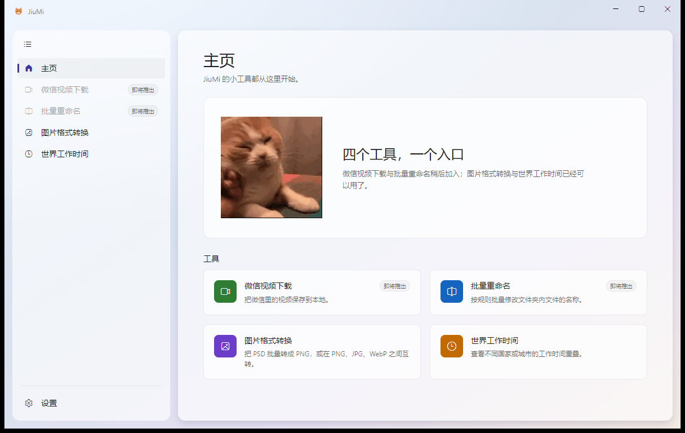
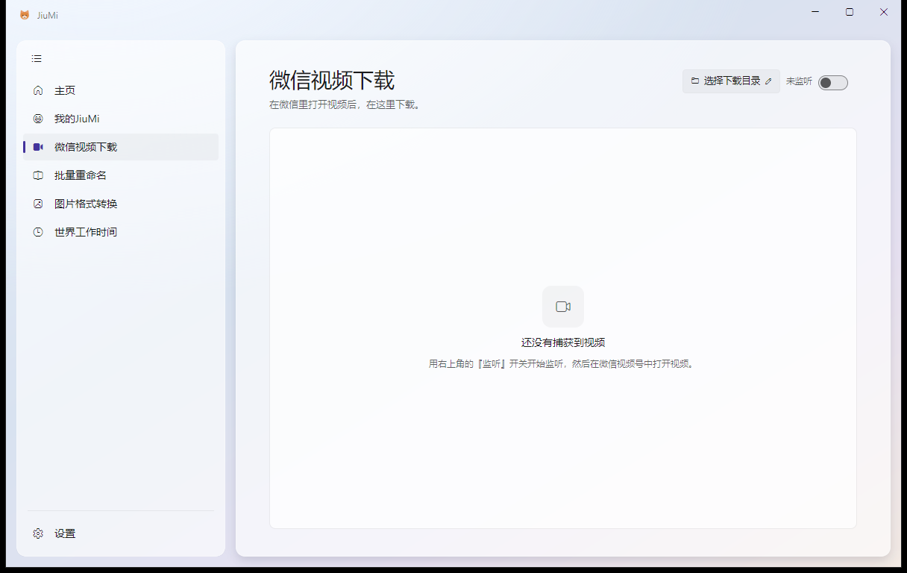
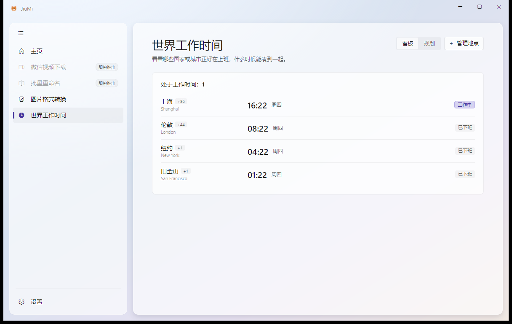
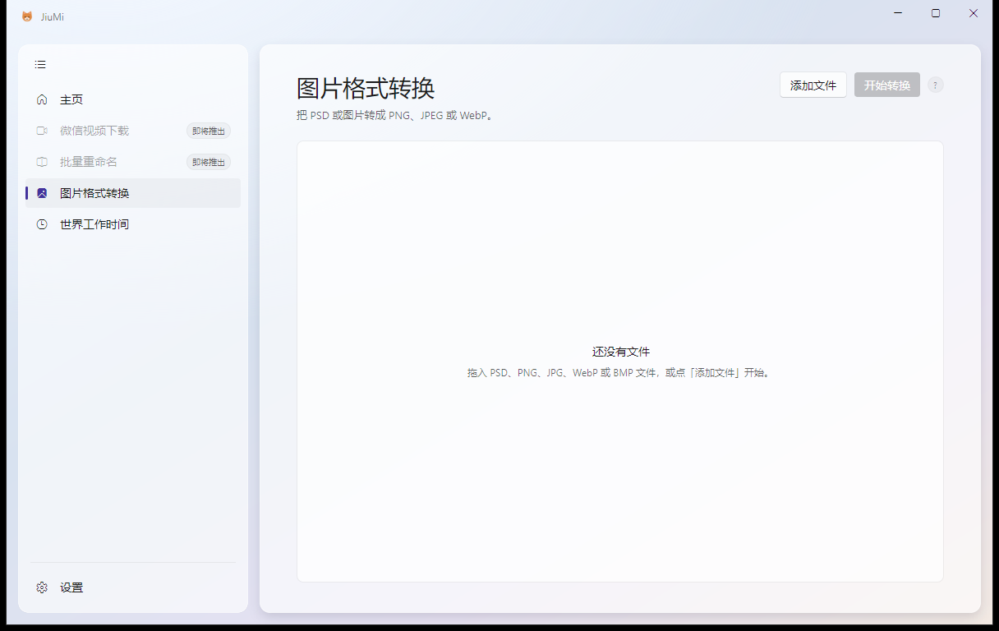

# JiuMi
- [x] 微信视频下载
- [x] 批量重命名
- [x] 图片格式转换（PSD 转 PNG 等）
- [x] 世界工作时间

## 主页

## 微信视频下载

## 世界工作时间

## 图片格式转换

## 开发

- 运行：`dotnet run --project src/JiuMi.Desktop`
- 结构：`src/` 为产品项目，`test/` 为测试项目
- 门禁：`pwsh ./verify.ps1`（Release 构建 + 测试 + 格式检查）
- 打包：`pwsh ./publish.ps1`（自包含 win-x64，产物在 `artifacts/JiuMi-<版本>-win-x64.zip`）
- 发版：推送 `v<版本>` tag 触发 `.github/workflows/release.yml`（先跑 `verify.ps1`，再打包并调用 `tools/publish-release.ps1` 同步发布到 GitHub 与 Gitee，最后更新 `app-update` Release 的 `update.json` 清单）；本地补救可重跑 `pwsh ./tools/publish-release.ps1`（幂等，支持 `-SkipGitee`；Gitee 单附件限 100MB、仓库附件总量限 1GB，超 80% 自动告警，不自动删除旧附件）
- 版本：语义版本来自 `Directory.Build.props` 的 `<Version>`；informational version 带 `+<commit>`，「关于」只显示语义版本
- CI：`ci.yml` 在指向 `dev` 或 `master` 的 pull request 上跑门禁并归档 Windows 产物（只改 `docs/**` 或 Markdown 时跳过）；`release.yml` 在推送 `v*` tag 时发版
