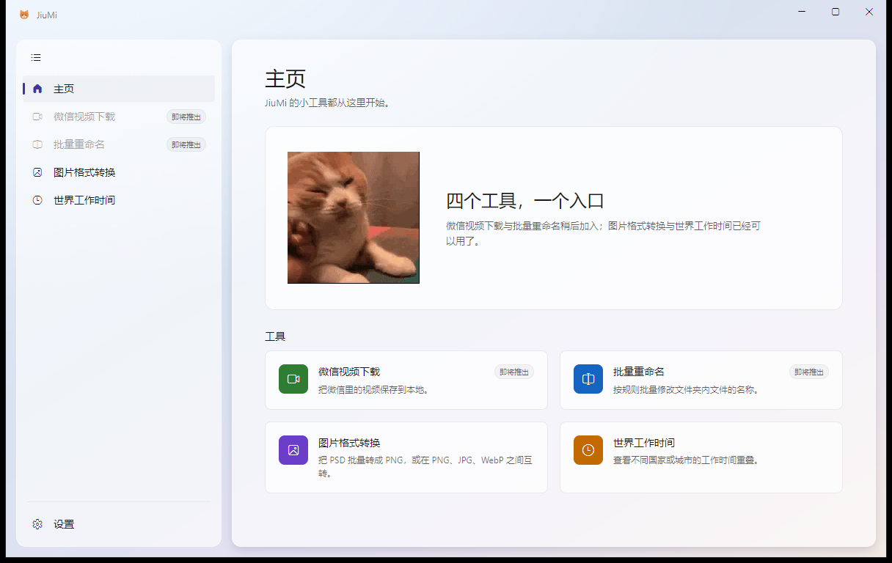
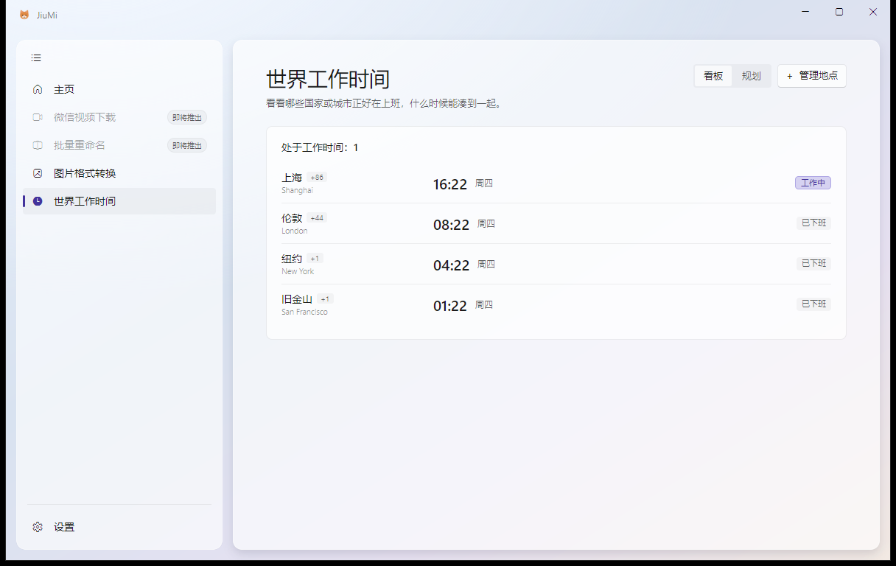
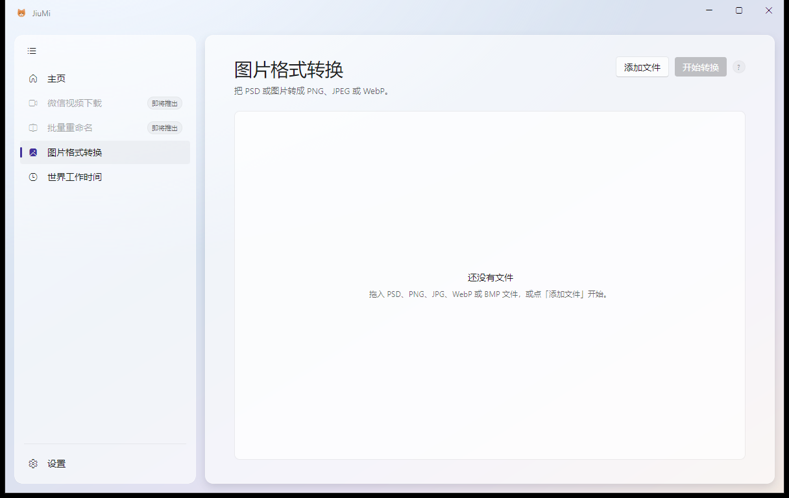

# JiuMi
- [ ] 微信视频下载
- [ ] 批量修改文件夹下文件名称
- [ ] 图片格式转换（PSD 转 PNG 等）
- [ ] 世界工作时间

## 主页

## 世界工作时间

## 图片格式转换

## 开发

- 运行：`dotnet run --project src/JiuMi.Desktop`
- 结构：`src/` 为产品项目，`test/` 为测试项目
- 门禁：`pwsh ./verify.ps1`（Release 构建 + 测试 + 格式检查）
- 发布：`pwsh ./publish.ps1`（自包含 win-x64，产物在 `artifacts/JiuMi-<版本>-win-x64.zip`）
- 版本：语义版本来自 `Directory.Build.props` 的 `<Version>`；informational version 带 `+<commit>`，「关于」只显示语义版本
- CI：GitHub Actions 在每次推送与 pull request 上跑门禁并归档 Windows 产物
