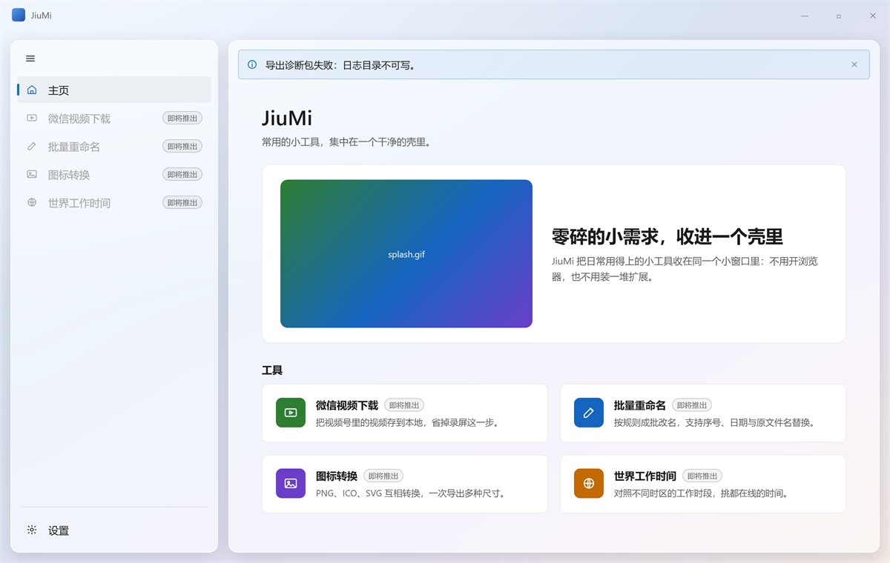
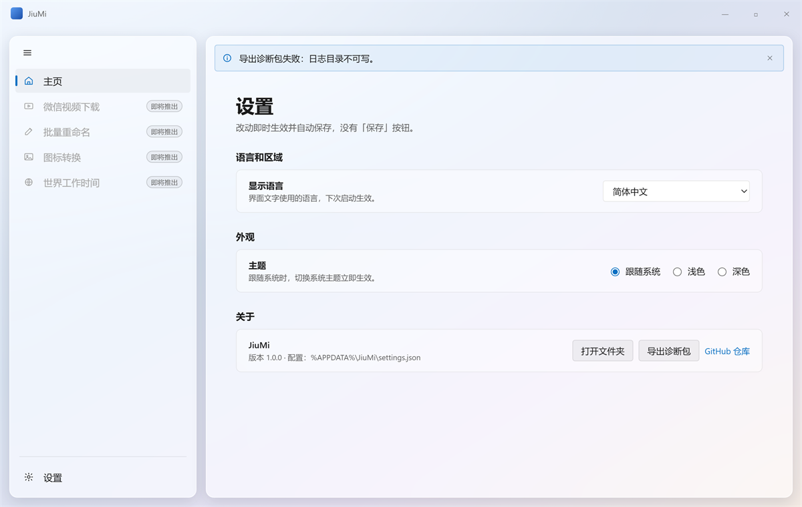
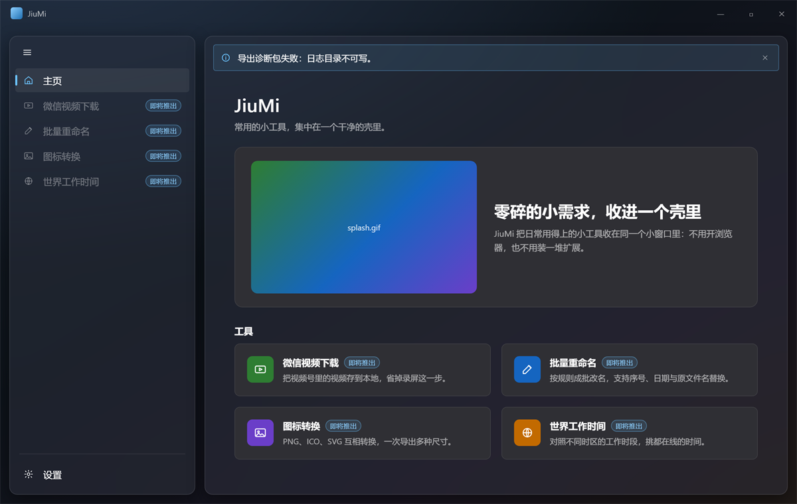
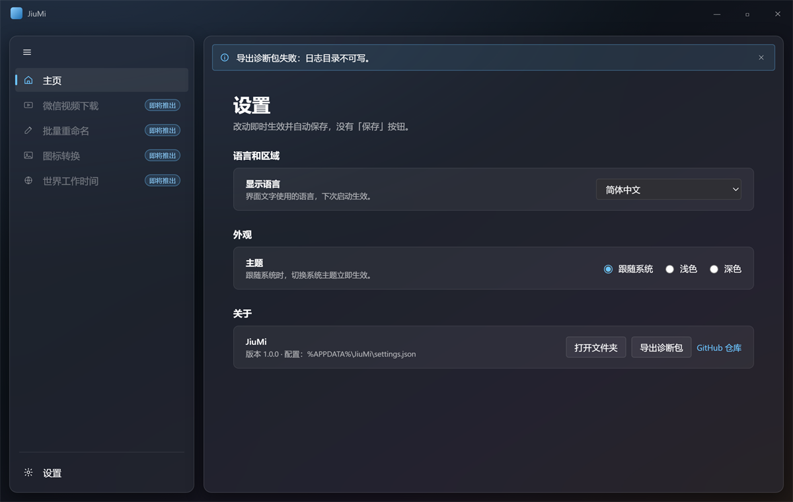

# UI 规格

JiuMi 应用外壳的视觉与交互规格。跨模块的结构规则见 [`docs/architecture.md`](./architecture.md)，单点决策的论证见 [`docs/adr/`](./adr/)。

## 通用规则

- 颜色一律引用 FluentAvalonia 的主题资源，不写死色值：浅色、深色与高对比度随主题自动成立。例外只有工具徽标的固定品牌色与「即将推出」徽标，见「主题」章节。
- 尺寸是 100% 文本缩放下的默认值；缩放到 200% 时以「不裁切、可滚动」为准。
- 文案一律走本地化绑定，键名见 [`docs/architecture.md`](./architecture.md) 本地化章节的已登记键表；本文件新增的键已同步登记在那里。
- 视图里不拼文案：标题、说明、按钮文字各取一个键，不把两段文本拼成一句。

## 参考图

四张 1200 × 760 原型截图是本规格的视觉基准，取自 throwaway 分支 [prototype/issue-5-dark-theme](https://github.com/ZLiLiang/JiuMi/tree/prototype/issue-5-dark-theme)。原型 HTML 不进 `dev`，截图作为 primary source 迁入 `docs/images/`。深色截图定案于「深色主题下主页与设置页的视觉是否成立？」；浅色截图按同一结构重出，两套主题只换颜色。

### 浅色

### 深色

## 窗口与导航

### 主窗口

| 项 | 值 |
| --- | --- |
| 窗口 | `FAAppWindow`（FluentAvalonia 3；3.0 起由 `FluentWindow` 更名），标题栏由它提供，不自绘外框 |
| 默认尺寸 | 1200 × 760 |
| 最小尺寸 | 900 × 600，可放大、不设最大尺寸 |
| 背景 | `MicaBackdrop`（系统支持时）；不支持时回退 `SolidBackgroundFillColorBaseBrush` |
| 标题栏 | 高 40；左侧应用标记 18 × 18（圆角 4 的占位渐变块，正式图标见地图「Not yet specified」）+ 应用名 12px `TextFillColorSecondaryBrush`；**不显示当前页面名** |
| 主体 | 标题栏下方两列：导航栏固定宽 + 内容区 `*` |

- 窗口默认位置由系统决定，不做自定义居中。
- 尺寸、位置与最大化状态都**不记忆**：每次启动按上表的默认尺寸打开（见 [ADR-0005](./adr/0005-window-state-memory.md)）。
- 页面级布局全部落在内容区，导航栏不随页面变化。

### 导航栏

| 项 | 值 |
| --- | --- |
| 宽度 | 展开 280；收起 48 |
| 内边距 | 8 8 12 |
| 顶部按钮区 | 36 × 32 图标按钮，圆角 4，与导航项左对齐，**只有图标、不带文字** |
| 导航项 | 高 36，圆角 4，项间距 2，内边距 0 12 |
| 图标 | 16 × 16；图标与文字间距 14 |
| 文字 | 14px / Regular / `TextFillColorPrimaryBrush` |
| 悬停 | 整行 `SubtleFillColorSecondaryBrush` |
| 分隔线 | 1px `DividerStrokeColorDefaultBrush`，外边距 6 12 |

- 自上而下：展开/收起按钮 → 主页 → 四个工具 → 弹性空白 → 分隔线 → 设置（贴底）。
- 四个工具项本期**禁用**：文字与图标取 `TextFillColorDisabledBrush`，不接收焦点、不响应悬停，右侧挂「即将推出」徽标（`Common.ComingSoon`）。
- **选中态**：整行填充；左侧 3 × 16、圆角 2 的 `AccentFillColorDefaultBrush` 指示条；图标改为强调色并使用填充变体，文字颜色不变。
- **收起态**：只剩图标、水平居中；项文案转为 `ToolTip`，可访问名仍取同一键。
- 默认展开。展开/收起是**唯一被记忆的状态**（`settings.json` 的 `navExpanded`，见 [`docs/architecture.md`](./architecture.md) 配置章节）：启动时恢复上次关闭时的状态；点按钮立即改变界面但不立即写盘，退出时统一落盘。

### 内容区骨架

- 内容区纵向滚动（`ScrollViewer` 纵向 `Auto`、横向禁用），页面内边距 32 44 36。
- 页面标题 28px / SemiBold / `TextFillColorPrimaryBrush`；副标题 13px / Regular / `TextFillColorSecondaryBrush`，与标题间距 6。
- 全局 InfoBar 占据内容区第一行、页面骨架之上（见「错误呈现」）。

### 可访问性

- 导航项是可聚焦的标准项：`Tab` 进入导航栏，上下方向键在本组内移动，`Enter` 激活；禁用项不进焦点顺序。
- 展开/收起按钮可获得焦点，`AutomationProperties.Name` 按当前状态取 `Shell.Nav.Expand` / `Shell.Nav.Collapse`。
- 选中态不只靠颜色：整行填充、左侧指示条、图标填充变体三者同时存在。
- 导航栏宽度固定，不随字号膨胀：收起态只留图标，展开态文字超长时省略并带 `ToolTip`。
- 文本缩放到 200% 时由内容区滚动承接，导航栏与标题栏不随之变形。

## 主页

标题取 `Home.Title`，副标题取 `Home.Subtitle`。标题下一块 hero，再下一块工具卡网格。

### hero

| 项 | 值 |
| --- | --- |
| 外边距 | 上 22，左右 0 |
| 内边距 | 20 24 |
| 圆角 | 12 |
| 填充 / 描边 | `CardBackgroundFillColorDefaultBrush` + 1px `CardStrokeColorDefaultBrush` |
| 布局 | 横向两列：媒体区按素材适配 + 文案区 `*`，纵向居中，列间距 26 |
| 媒体区 | 槽位上限 340 × 200，圆角 10，裁切到圆角；容器取素材等比适配后的尺寸 |
| 文案区 | 标题 24px / SemiBold；正文 13px / Regular / `TextFillColorSecondaryBrush`，行高 1.6，最大宽度 430，与标题间距 8 |

- 媒体区播放 `splash.gif`，`IterationCount` 保持 `Infinite`（主页要一直动）：素材在 340 × 200 槽位内等比适配，容器跟随适配结果——不拉伸、不裁切，也不留空带。
- 媒体加载失败时按「容器内占位」降级，不改变 hero 高度。
- 媒体是装饰性动画，不设可访问名：信息由右侧文案承担。
- 文案键：`Home.Hero.Title`、`Home.Hero.Body`。

### 工具卡网格

| 项 | 值 |
| --- | --- |
| 分区标题 | 14px / SemiBold，上 26、下 10，键 `Home.Tools.Title` |
| 列 | 两列等宽，列间距 16，行间距 16 |
| 卡片 | 圆角 8，内边距 18，`CardBackgroundFillColorDefaultBrush` + 1px `CardStrokeColorDefaultBrush` |
| 卡片内部 | 徽标固定宽 + 文字 `*`，列间距 14，顶对齐 |
| 徽标 | 40 × 40，圆角 8，图标 20 × 20 纯白 |
| 卡片标题 | 14px / SemiBold；与「即将推出」徽标间距 8 |
| 卡片描述 | 12px / Regular / `TextFillColorSecondaryBrush`，行高 1.5，与标题间距 5 |

- 四张卡片按「微信视频下载、批量重命名、图标转换、世界工作时间」排列，标题取 `Tool.<工具>.Name`，描述取 `Tool.<工具>.Description`。
- 每张卡片都带「即将推出」徽标（`Common.ComingSoon`）。
- 卡片本期**不可交互**：无悬停高亮、无手型光标、不接收焦点；同排卡片等高。
- 内容区宽度小于 760 时，网格降为单列、hero 改为纵向堆叠（媒体在上、文案在下，媒体仍按素材等比适配并水平居中，不撑满整行）。

## 设置页

标题取 `Settings.Title`，副标题取 `Settings.Subtitle`。页面骨架同主页，内容最大宽度 800、左对齐。

### 分区与行

| 项 | 值 |
| --- | --- |
| 分区间距 | 26 |
| 分区标题 | 14px / SemiBold，下边距 8 |
| 分组卡 | 圆角 8，1px `CardStrokeColorDefaultBrush`，`CardBackgroundFillColorDefaultBrush`，圆角裁剪 |
| 行 | 内边距 14 18；标签列 `*`、控件列 `Auto`，列间距 16；行间 1px `DividerStrokeColorDefaultBrush` |
| 行标签 | 标题 13px / SemiBold；说明 11.5px / Regular / `TextFillColorSecondaryBrush`，与标题间距 2 |

### 分区清单

1. **语言和区域**（`Settings.Language.Section`）：一行「显示语言」（`Settings.Language.Label` / `Settings.Language.Hint`），控件是 `ComboBox`：最小宽 220、高 32、圆角 4、13px；选项为 `languages.json` 的 `displayName`，顺序同清单。
2. **外观**（`Settings.Appearance.Section`）：一行「主题」（`Settings.Appearance.Label` / `Settings.Appearance.Hint`），控件是三个 `RadioButton` 水平排列、间距 14、13px，顺序为跟随系统 / 浅色 / 深色（`Settings.Appearance.FollowSystem` / `.Light` / `.Dark`），默认「跟随系统」。
3. **关于**（`Settings.About.Section`）：左侧应用名、版本行（`Settings.About.Version`，`{0}` 为版本号，取程序集的 informational version）与生效配置路径（原样文本，等宽 11.5px / `TextFillColorSecondaryBrush`，单行、`CharacterEllipsis` 截断，完整路径作为提示）；右侧动作组水平排列、间距 8，依次为 `Button`「打开文件夹」（`Common.OpenFolder`）、`Button`「导出诊断包」（`Settings.About.ExportDiagnostics`）、`HyperlinkButton`「GitHub 仓库」（`Settings.About.Repository`，12.5px、强调色，打开仓库页）。

- 修改**即时生效并自动保存**：没有「保存」按钮、没有确认对话框、没有「已保存」提示。
- 「导出诊断包」走系统保存对话框：默认文件名 `JiuMi-diagnostics-yyyyMMdd-HHmmss.zip`，默认目录为当前生效的 `logs\`。导出期间按钮禁用，结束后恢复；打包内容与失败处理见 [`docs/architecture.md`](./architecture.md) 的日志与诊断章节。
- 日志初始化或写入失败时，关于区在路径下方显示一行「日志不可用」（`Settings.About.LoggingUnavailable`，11.5px / `SystemFillColorCautionBrush`），不弹提示、不放按钮；写入恢复后该行消失。

## 主题

- 三态：跟随系统（默认）、浅色、深色；落盘规则见 [`docs/adr/0001-settings-persistence.md`](./adr/0001-settings-persistence.md) 与架构的配置章节。
- 切换即时生效，不重启、不播放过渡动画。
- 深色与浅色**共用同一结构**，只换颜色资源：不出现只在一套主题下才有的控件、间距或层级。
- 表面层级：窗口用 Mica（或回退实色）作底，卡片与 hero 用 `CardBackgroundFillColorDefaultBrush` 浮在其上，靠 1px 描边而不是重阴影分层（两套主题都只有 `0 1 2` 级别的极浅投影）。
- 主题资源缺失时回退 Fluent 默认主题，只记 Debug（架构已定）。

### 两处固定配色

- **工具徽标**：底色是各工具自己的品牌色，不随主题变，图标纯白。微信视频下载 `#2E7D32`、批量重命名 `#1565C0`、图标转换 `#6A3EC8`、世界工作时间 `#C26A00`。
- **「即将推出」徽标**：10px，圆角 9，内边距 2 6。深色下用强调色系（浅蓝文字 + 强调色 42% 描边 + 14% 底色）保证对比度；浅色下只用次级文字色 + `ControlStrokeColorDefaultBrush` 描边 + `SubtleFillColorSecondaryBrush` 底色，不抢视觉权重。

## splash

窗口行为（`SystemDecorations=None`、不可缩放、不显示在任务栏、居中、不可拖动、不透明背景）见 [`docs/architecture.md`](./architecture.md) 的启动序列章节；本节补尺寸、进度环与淡变曲线。

| 项 | 值 |
| --- | --- |
| 尺寸 | 320 × 320，固定：与 `splash.gif` 的方形画面同比例，窗口内不出现边框带 |
| 内边距 | 0，媒体铺满整个窗口 |
| 媒体区 | 与窗口同尺寸 |
| 媒体适配 | 媒体铺满整个窗口。`GifImage` 按自身 bounds 绘制、不响应 `Stretch`，所以「不出现留白带」由窗口的方形形状本身保证，而不是靠某种拉伸模式 |
| 进度环 | 32 × 32，环宽 3，`AccentFillColorDefaultBrush`，与媒体区同心 |
| 文字 | 无 |

- **背景锁定**：取 splash 创建时的系统主题变体（`SolidBackgroundFillColorBaseBrush`），生命周期内不跟随用户主题或系统切换重绘——用户主题要到初始化第 3 步才应用，跟着变会在动画中途闪一下。
- **进度环时机**：只在降级档 ②③ 与 `Waiting` 状态出现；GIF 停画与环出现同一帧完成（`Source = null` 与环可见性一起切换），不做淡入淡出。
- **不显示文字**：不写应用名、版本或「正在启动」——本地化可能尚未加载，且 splash 只有一瞬。
- **交接淡变**：主窗口 `0 → 1`、splash `1 → 0`，同时开始、同时结束，200ms，缓动 `CubicEaseOut`，无延迟、无缩放或位移。用缓出而不是线性：这是一次纯退场式过渡，开头快、结尾缓，与 Fluent 的淡出节奏一致；200ms 的线性淡变会显得发硬。
- 降级档 ④（splash 窗口建不出来）没有淡变对象，直接显示主窗口，架构已定。

## 视觉 token

页面里只用下面几档，不临时新增相邻值。

### 间距

| 用途 | 值 |
| --- | --- |
| 导航项内边距 | 横向 12 |
| ComboBox 内边距 | 横向 10 |
| 卡片内边距 | 18 |
| hero 内边距 | 20 24 |
| 页面内边距 | 上 32 / 左右 44 / 下 36 |
| 导航图标与文字 | 14 |
| 卡片徽标与文字 | 14 |
| 「即将推出」徽标与卡片标题 | 8 |
| 网格间距 | 16 |
| 分区间距 | 26 |
| 分区标题与分组卡 | 8 |
| 页面标题与副标题 | 6 |
| 卡片标题与描述 | 5 |

### 圆角

| 用途 | 值 |
| --- | --- |
| 控件、导航项、ComboBox | 4 |
| 卡片、设置分组卡、工具徽标、窗口内圆角块 | 8 |
| hero 媒体区 | 10 |
| hero 卡 | 12 |
| 徽标胶囊 | 9（10px 文字 + 上下 2 内边距 + 1px 描边后取半高） |

### 字号与字重

| 用途 | 字号 | 字重 |
| --- | --- | --- |
| 「即将推出」徽标 | 10 | Regular |
| 行说明 | 11.5 | Regular |
| 卡片描述 | 12 | Regular |
| 超链接按钮 | 12.5 | Regular |
| 正文、副标题、控件文字 | 13 | Regular |
| 卡片标题、分区标题、行标签标题 | 14 | SemiBold |
| 导航项文字 | 14 | Regular |
| hero 标题 | 24 | SemiBold |
| 页面标题 | 28 | SemiBold |

- 字体取 Fluent 默认主题字体（`ContentControlThemeFontFamily`），中文按其回退链落到系统字体。

### 图标

| 用途 | 尺寸 |
| --- | --- |
| 下拉箭头等小指示 | 10 |
| 导航项、行内图标、InfoBar | 16 |
| 应用标记 | 18 |
| 卡片徽标 | 20 |
| 容器占位 | 24 |
| 错误窗口 | 32 |

### 颜色角色

| 角色 | 资源 |
| --- | --- |
| 主文字 | `TextFillColorPrimaryBrush` |
| 次文字、说明、副标题 | `TextFillColorSecondaryBrush` |
| 禁用文字与图标 | `TextFillColorDisabledBrush` |
| 卡片填充 | `CardBackgroundFillColorDefaultBrush` |
| 卡片与控件描边 | `CardStrokeColorDefaultBrush` / `ControlStrokeColorDefaultBrush` |
| 分隔线 | `DividerStrokeColorDefaultBrush` |
| 强调色（选中指示条、进度环、超链接、单选钮） | `AccentFillColorDefaultBrush` |
| 窗口基底（Mica 不可用时） | `SolidBackgroundFillColorBaseBrush` |
| 悬停底色 | `SubtleFillColorSecondaryBrush` |

## 错误呈现

分级、载体选择与场景映射是架构规则，见 [`docs/architecture.md`](./architecture.md) 的「错误呈现与诊断」章节。本节只定位置、尺寸、间距、排版与交互。

### 全局 InfoBar

#### 位置

- 挂在主窗口内容区顶部、导航栏右侧，横跨内容区整宽。
- 推挤内容而不是覆盖：占据内容 `Grid` 的第一行，`Margin="16,12,16,0"`。
- 导航栏展开或收起时宽度跟随内容区，不移动到导航栏下方。
- 跨页常驻：切换页面不清空、不重建。

#### 尺寸与排版

| 项 | 值 |
| --- | --- |
| 外边距 | 左 / 右 16，上 12，下 0 |
| 内边距 | 16, 12 |
| 圆角 | 4 |
| 最小高度 | 48 |
| 图标 | 16 × 16，与文字间距 12，与首行文字垂直居中对齐 |
| 文案 | 14px / Regular / `TextFillColorPrimaryBrush`，行高 20，可换行 |
| 关闭按钮 | 32 × 32，图标 12，悬停底 `SubtleFillColorSecondaryBrush` |

- **只有一个文案位**，取 `Error.<code>`；不在 InfoBar 里拼标题与正文两段。
- 同一 `code` 合并后，文案尾部追加 `Common.ErrorCountSuffix`（`（已发生 {0} 次）`），计数变化只更新这一段文本。

#### 配色

| 级别 | 图标 / 强调 | 背景 | 边框 |
| --- | --- | --- | --- |
| Error | `SystemFillColorCriticalBrush` | `SystemFillColorCriticalBackgroundBrush` | `ControlStrokeColorDefaultBrush` |
| Warning | `SystemFillColorCautionBrush` | `SystemFillColorCautionBackgroundBrush` | 同上 |

- Error 用圆形叉图标，Warning 用三角形感叹图标：级别不靠颜色区分。
- 常驻类（`Config.MemoryOnly`）配色同 Error，但不渲染关闭按钮。

#### 生命周期

- 同时只有一条可见；其余按（级别、时间）排队，Error 在 Warning 之前；当前条关闭或自动收起后显示下一条。
- Error：手动关闭。
- Warning：8 秒自动收起；指针悬停或键盘焦点落在其内时暂停计时，移出后重新计满 8 秒。
- 常驻类：不可关闭、不参与自动收起，直到条件解除。
- 内容切换不做过渡动画。

#### 多动作布局

- InfoBar 只有一个 `ActionButton`，放主操作（重试 / 打开文件夹）：`Button` 默认样式，高 32，右侧对齐，与文字间距 12。
- 「复制详情」不做成按钮：正文末尾一个 `HyperlinkButton`（12px）。复制成功后自身文本在 2 秒内显示 `Common.Copied`，随后复原。
- 内容区宽度小于 640 时，动作按钮换到下一行、左对齐，正文先占满整行。

#### 启动期入队

主窗口出现前产生的非阻断记录只入队；主窗口首次激活后按排队顺序开始显示（见 [`docs/architecture.md`](./architecture.md) 启动序列章节）。

### 容器内占位

局部资源加载失败时就地降级，不弹提示。

| 项 | 值 |
| --- | --- |
| 填充 | 透明，不铺底色 |
| 边框 | 1px 虚线 `ControlStrokeColorDefaultBrush` |
| 圆角 | 4，与所在卡片一致 |
| 图标 | 24 × 24 居中，`TextFillColorSecondaryBrush` |
| 文案 | 可选，12px / Regular / `TextFillColorSecondaryBrush`，与图标间距 8 |

- 占位不改变容器尺寸，不引起布局跳动。
- splash 的降级形态由启动序列决定（四档阶梯），不走本占位；本占位只用于主窗口内的图片容器。

### 错误窗口

#### 窗口属性

| 项 | 值 |
| --- | --- |
| 尺寸 | 420 × 240，固定 |
| 可缩放 | 否 |
| 位置 | 屏幕居中 |
| 任务栏 | 显示（它可能是进程唯一的窗口） |
| 系统装饰 | 默认标题栏，可拖动，带关闭 X |
| 标题 | 应用名，内嵌常量 |
| 主题 | Fluent 默认主题，不读用户主题设置 |
| 实例 | 每进程最多一个；已在显示时再发生致命错误，写日志后直接退出，不叠加 |

#### 布局与排版

- 内边距 24。
- 图标 32 × 32（Error 圆形叉），与标题同一行，间距 12。
- 标题：20px / SemiBold / `TextFillColorPrimaryBrush`，行高 28，最多两行，超出省略。
- 正文：14px / Regular / `TextFillColorSecondaryBrush`，行高 20，最多四行，超出省略；左边缘对齐标题左边缘（缩进 44）。
- 字体使用 Fluent 默认主题字体（`ContentControlThemeFontFamily`）。
- 垂直结构：内容区 `*` + 按钮组 `Auto`，按钮组贴底；图标、标题、正文、详情依次排列，标题与正文间距 8，正文与详情间距 12，详情与按钮组间距 16。

#### 文案

- 内嵌 zh-CN 常量，不走 i18n：错误窗口可能出现在本地化初始化完成之前，也可能出现在语言文件损坏时。窗口文案不随语言切换变化。

#### 按钮组

| 变体 | 按钮（从左到右） | 默认 / 回车 | 关闭 X | Esc |
| --- | --- | --- | --- | --- |
| 阻断：启动期失败、主窗口不可用 | 复制详情（次要）、退出（主） | 退出 | 退出 | 退出 |
| 可继续：主窗口可用时的 UI 线程未捕获异常 | 复制详情（次要）、退出（次要）、继续运行（主） | 继续运行 | 继续运行 | 继续运行 |

- 按钮右对齐，高 32，间距 8；主按钮使用 `AccentButtonStyle`。

#### 详情

- 按钮组上方一个 `Expander`，标题「查看详情」；折叠时占 32 高，窗口尺寸不变。
- 展开后占用正文与按钮组之间的剩余高度（约 96），内容为只读 `TextBox`：`IsReadOnly=True`、`AcceptsReturn=True`、不换行、纵向滚动、可选中复制；字体 `Cascadia Mono, Consolas, monospace`，12px。
- 内容是错误记录的复制格式（字段一行一个），不加额外说明文字。
- 展开与折叠都不改变窗口尺寸。

#### 复制

- 「复制详情」写入剪贴板的内容与 InfoBar 的 `HyperlinkButton` 完全一致（见 [`docs/architecture.md`](./architecture.md) 错误记录章节的复制格式）。
- 复制成功不弹提示：按钮文本在 2 秒内显示「已复制」，随后复原（内嵌常量，不走 i18n）。

### 可访问性

- InfoBar 根元素设 `AutomationProperties.LiveSetting="Polite"`；消息文本的 `AutomationProperties.Name` 为完整文案。
- 级别不靠颜色：Error 与 Warning 使用不同图标形状。
- Warning 的自动收起在指针悬停或焦点进入时暂停；关闭按钮可获得焦点、可用键盘触发。
- 错误窗口打开即聚焦默认按钮；`Tab` 在按钮与详情之间循环；Esc 与关闭 X 的语义一致。
- 详情框获得焦点时不吞 Esc：Esc 仍执行窗口的默认动作。
- 文本缩放：InfoBar 高度自适应、动作按钮按宽度换行；错误窗口尺寸不变，正文与详情区滚动而不是撑破窗口。
- 高对比度：全部颜色取自主题资源，不做额外覆盖。

## 托盘

单实例、窗口生命周期与激活规则是架构规则，见 [`docs/architecture.md`](./architecture.md) 的「单实例与窗口生命周期」章节。本节只定托盘入口的图标、菜单与提示。

### 图标

- 用与主窗口任务栏图标同一份占位资源（`Assets/` 下），不改画单色剪影、不做 16 / 20 / 24 多尺寸打包；托盘区按自身逻辑尺寸缩放。
- 不显示状态叠加：无错误角标、无进度、不闪烁、不弹气泡。

### 最小化与恢复

- 最小化即隐藏：主窗口从任务栏与 Alt+Tab 中消失，只剩托盘图标；恢复的唯一入口是托盘（单击图标、菜单「显示主窗口」，或系统通知）。
- 恢复后回到最小化前的尺寸、位置与窗口状态（最大化仍是最大化）。
- 最小化与恢复都不做过渡动画。

### 右键菜单

- 项顺序固定：显示主窗口（`Shell.Tray.Show`）／设置（`Shell.Tray.Settings`）／退出（`Shell.Tray.Exit`），不追加其他项。
- 用 Fluent `ContextMenu` 默认样式：14px、行高 32、圆角 4，不自定义配色；键盘上下移动与 `Enter` 触发按默认行为。
- 「设置」= 先恢复并激活主窗口，再执行导航栏「设置」的**同一条**导航命令；已在设置页时不重复导航，因此返回行为与手动点击导航完全一致。
- 「退出」与关闭按钮同一条退出路径，不额外确认。

### 首次最小化提示

- 每会话最多一次：第一次最小化到托盘时投递系统通知，此后不再提示。
- 正文取 `Shell.Tray.MinimizedHint`，只一句、不带技术细节；标题为应用名（沿用错误呈现的通知内容规则）。
- 通过 `IUserNotification` 投递，不用托盘气泡 API；点击通知等同于单击托盘图标。
- 不阻塞、不抢焦点、不改变窗口的隐藏状态。

### 隐藏期间的提示

- 隐藏到托盘时没有可见窗口，非阻断 Error 走系统通知（触发规则见 [`docs/architecture.md`](./architecture.md) 的错误呈现章节）；托盘图标不承担未读状态。
- 错误窗口本身就是可见窗口，它出现时不投递系统通知。

### 可访问性

- 托盘菜单项是标准菜单项，可键盘操作；各项 `AutomationProperties.Name` 取同一文案键。
- 首次最小化提示只出现一次，且不携带必须完成的操作，不构成阻断。
